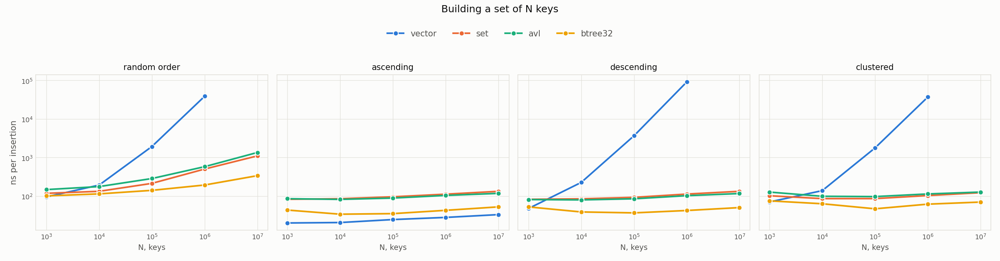
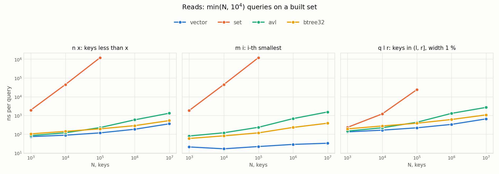
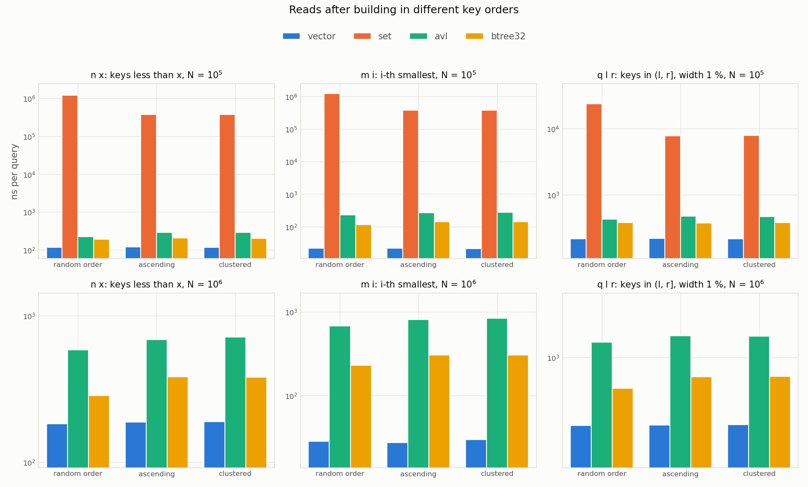
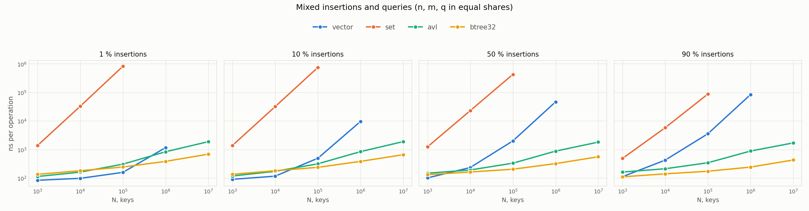
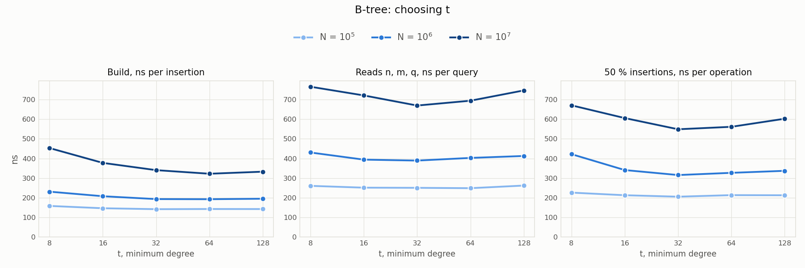

# Performance research

This folder compares the four structures from the [main README](../README.md) on the same command streams, from 1,000 to 10,000,000 keys. How to build the programs and rerun the experiments is described in the [Benchmark](../README.md#benchmark) section.

## Contents

- [Method](#method)
- [Building a set](#building-a-set)
- [Reads by set size](#reads-by-set-size)
- [Reads by insertion order](#reads-by-insertion-order)
- [Mixed insertions and queries](#mixed-insertions-and-queries)
- [B-tree minimum degree](#b-tree-minimum-degree)
- [Memory](#memory)
- [Conclusions](#conclusions)
- [Data](#data)

## Method

Each stream starts with `N` insertions that build the set. Build-only streams end there. Read and mixed streams continue with `M = min(N, 10,000)` operations. The benchmark measures the two phases separately, so the plots show either the time per insertion or the time per operation. Parsing the input and freeing memory are not measured.

The keys are `N` values spread evenly over the `int` range and shuffled. An `n` query takes a random key, an `m` query takes a random position, and a `q` range covers 1 % of the keys.

Within each experiment, all structures selected for a point receive the same stream for a given seed. The runner completes all points for one seed before moving to the next. The plots show the median time per insertion or operation over seeds 1 to 10.

Each run uses a separate process pinned to logical CPU 2. All 2,860 runs finished within the five-minute limit. Two size limits keep the experiment practical.

- `set` answers `n` and `m` in $O(n)$, so its queries are measured only up to $10^5$ keys.
- At $10^6$ keys, building `vector` in random order already costs 38.9 µs per insertion. At $10^7$ keys, only the ascending build and reads on that vector are measured.

Environment:

| | |
|---|---|
| CPU | Intel Core i7-12650H |
| OS | Windows 11 (x64) |
| Compiler | GCC 16.2.0 (MSYS2 UCRT64) |
| Build | Release (`-O3`) |

## Building a set

How much one insertion costs, depending on the set size and the order of keys.

The cost of an insertion into `vector` grows with the number of keys it has to shift. In random order it is 96 ns at $10^3$ keys, 1,935 ns at $10^5$ and 38,898 ns at $10^6$. In descending order every key goes to the front, and at $10^6$ an insertion takes 91.3 µs. In ascending order every key goes at the end. `vector` builds fastest at every measured size, from 20.2 ns per key at $10^3$ to 33.2 ns at $10^7$.

At $10^7$ keys an insertion costs:

| Order | `set` | `avl` | `btree32` |
|---|---|---|---|
| random | 1,107 ns | 1,357 ns | 340 ns |
| ascending | 133 ns | 118 ns | 53 ns |
| descending | 133 ns | 117 ns | 51 ns |
| clustered | 123 ns | 128 ns | 70 ns |

In ascending and descending order each insertion goes down almost the same path as the previous one, and this path is most likely still in the cache. In random order `avl` takes 3.0 times as long per insertion as `btree32` at $10^6$ keys and 4.0 times as long at $10^7$.

## Reads by set size

Sets are built in random order except for `vector` at $10^7$ keys, which is built in ascending order.

At $10^5$ keys, `set` takes about 1.21 ms to answer `n` or `m`. A `q` query walks only the selected range and takes 23.8 µs, about one fiftieth of that time.

`vector` is the fastest structure for every query and size. It answers `m` in 17–33 ns, and `n` and `q` are binary searches.

From $10^5$ keys `btree32` is faster than `avl` on every query, and the gap grows with the size. At $10^7$ keys:

| Query | `vector` | `avl` | `btree32` | `avl` / `btree32` |
|---|---|---|---|---|
| `n` | 358 ns | 1,311 ns | 530 ns | 2.5 |
| `m` | 33 ns | 1,532 ns | 384 ns | 4.0 |
| `q` | 652 ns | 2,680 ns | 1,067 ns | 2.5 |

This agrees with the idea of the B-tree: a query goes through fewer levels, and the keys of one node fit into a few adjacent cache lines.

## Reads by insertion order

The same reads on sets of $10^5$ and $10^6$ keys built in random, ascending and clustered order. The keys are the same in all three cases.

The order changes the read time of every structure, although the keys and the answers are the same. The largest difference between the fastest and the slowest order for each structure, over all three queries and both sizes:

| Structure | Query | Keys | Fastest order | Slowest order | Difference |
|---|---|---|---|---|---|
| `vector` | `m` | $10^6$ | ascending, 27.3 ns | clustered, 29.6 ns | 8.5 % |
| `set` | `m` | $10^5$ | ascending, 371 µs | random, 1,207 µs | 3.26 times |
| `avl` | `n` | $10^5$ | random, 224 ns | ascending, 291 ns | 30 % |
| `btree32` | `n` | $10^6$ | random, 284 ns | ascending, 382 ns | 34 % |

For `vector` the 8.5 % difference for `m` amounts to 2.3 ns. Its `n` and `q` times vary by at most 3.3 % across orders. `set` is the most sensitive to order. Each of its three queries takes about three times as long after random insertion as after ascending or clustered insertion.

## Mixed insertions and queries

Streams where insertions and queries are mixed. The queries are `n`, `m` and `q` in equal shares.

`vector` stays the fastest while there are few insertions and the set is small. With 1 % insertions it falls behind both trees at $10^6$ keys, and with 10 % at $10^5$. With 50 % insertions `btree32` leads from $10^4$ keys. With 90 % it has the lowest median even at $10^3$, where `btree32` and `vector` are close (110.4 and 111.7 ns per operation).

At $10^7$ keys, raising the share of insertions from 1 % to 90 % lowers the median for `btree32` from 685 to 429 ns per operation. Over the same two workloads, `avl` goes from 1,873 to 1,698 ns. Its time per operation is 2.7 times that of `btree32` at 1 % and 4.0 times at 90 %.

`set` takes about 0.8 ms per operation at $10^5$ keys even with 1 % insertions, because two thirds of the queries are `n` and `m`, which take $O(n)$.

## B-tree minimum degree

The same B-tree with `t` from 8 to 128: building, reads, and a stream with 50 % insertions.

At $10^7$ keys, ns:

| `t` | 8 | 16 | 32 | 64 | 128 |
|---|---|---|---|---|---|
| build | 453 | 378 | 341 | 322 | 333 |
| reads | 765 | 721 | 670 | 694 | 747 |
| 50 % insertions | 671 | 606 | 549 | 561 | 603 |

At $10^7$ keys, `t = 64` builds fastest and `t = 32` gives the fastest reads and mixed operations. The largest spread among `t = 16, 32, 64` occurs when building at this size. An insertion takes 378 ns with `t = 16`, about 17 % longer than with `t = 64`. The solver and the other experiments use `t = 32`.

## Memory

The table estimates storage from the 64-bit node layouts for `int` keys. It excludes allocator overhead. The benchmark measures time only.

| Structure | Allocation | Bytes per key |
|---|---|---|
| `vector` | one array of keys | 4, up to 8 after the array grows (its capacity doubles) |
| `set` | a 40-byte node per key: color, three pointers, key | 40 |
| `avl` | a 40-byte node per key: key, two pointers, height, subtree size | 40 |
| `btree32` | a 1,288-byte node for up to 63 keys | about 20 when nodes are full (63 keys), about 42 when they hold the minimum of 31 keys |

Every node of `btree32`, including leaves, has arrays for 64 children and their subtree sizes. In a leaf these 1,024 bytes are not used. Other values of `t` give about the same: 20–22 bytes per key in full nodes and 40–47 in nodes with the minimum number of keys.

## Conclusions

For a set built once and queried repeatedly, `vector` gives the fastest reads at every measured size. At $10^7$ keys, an ascending build costs 33 ns per key and an `m` query takes 33 ns. In mixed streams, `vector` leads up to $10^5$ keys with 1 % insertions, up to $10^4$ with 10 %, and up to $10^3$ with 50 %.

For sets of $10^6$ and $10^7$ keys, `btree32` leads on every measured mix of insertions and queries. At $10^7$ keys, it builds from random keys in a quarter of the time taken by `avl`. In the degree sweep at that size, `t = 32` is fastest for queries and `t = 64` for building.

`avl` beats `btree32` on small, read-heavy streams. At $10^3$ and $10^4$ keys it has lower medians with 1 % or 10 % insertions, although `vector` leads overall. With 50 % or 90 % insertions, `btree32` beats `avl` at every measured size.

`std::set` is not suited for rank queries. It does not keep subtree sizes, so counting keys and finding the i-th one take linear time, and at $10^5$ randomly inserted keys either query takes about 1.21 ms. The corresponding `avl` medians are 224 ns for `n` and 232 ns for `m`.

## Data

| File | What it is |
|---|---|
| [results/build.csv](results/build.csv) | building a set |
| [results/read_size.csv](results/read_size.csv) | reads by set size |
| [results/read_order.csv](results/read_order.csv) | reads by insertion order |
| [results/mix.csv](results/mix.csv) | mixed insertions and queries |
| [results/btree.csv](results/btree.csv) | B-tree with different `t` |
| [plots/](plots) | the plots above |
| [plots/throughput.md](plots/throughput.md) | throughput tables for reads and mixed streams |

Each CSV row is one run: experiment, structure, `N`, `M`, share of insertions, key order, query kind, `q` width, seed, the times of both phases in nanoseconds, and status. The plots and tables are drawn by [plot.py](plot.py) from these files.
