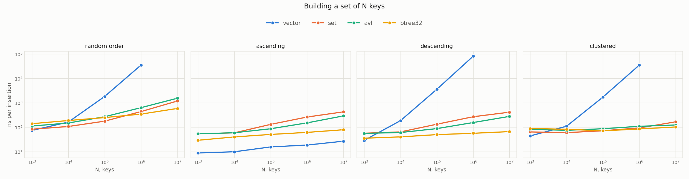
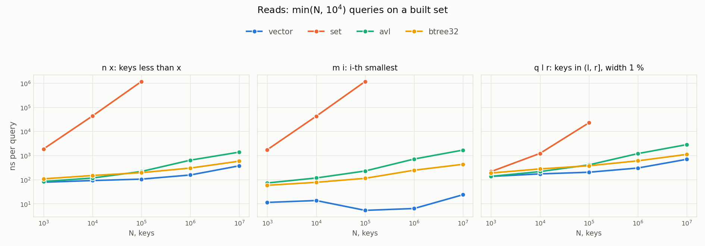
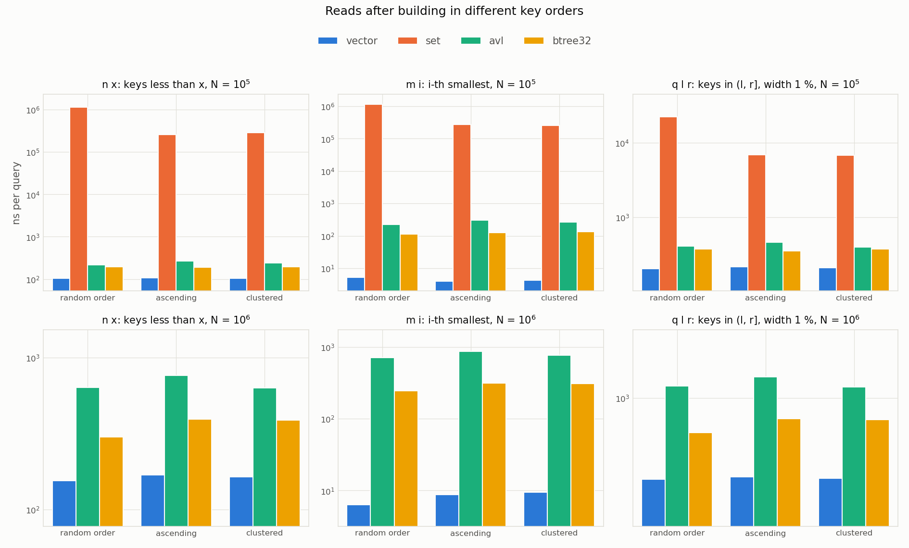
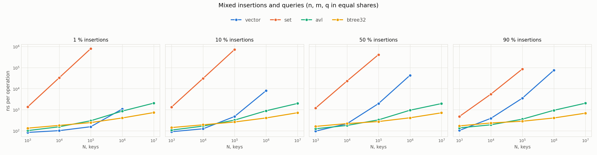
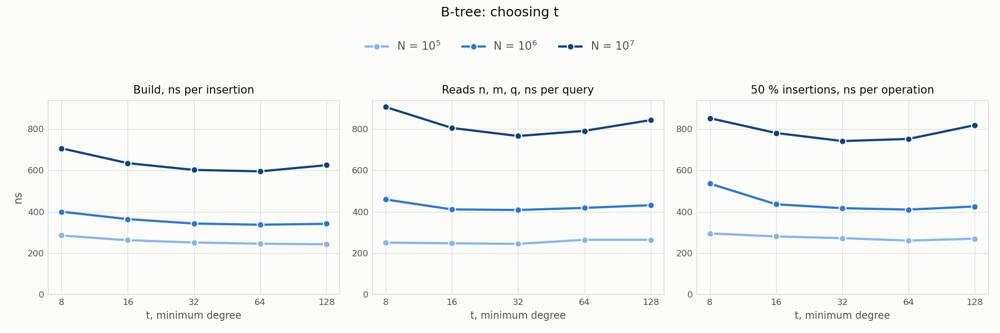

# Performance research

This folder compares the four structures from the [main README](../README.md) on the same command streams, from 1,000 to 10,000,000 keys. How to build the programs and rerun the experiments is described in the [Benchmark](../README.md#benchmark) section.

## Contents

- [Method](#method)
- [Building a set](#building-a-set)
- [Reads by set size](#reads-by-set-size)
- [Reads by insertion order](#reads-by-insertion-order)
- [Mixed insertions and queries](#mixed-insertions-and-queries)
- [B-tree minimum degree](#b-tree-minimum-degree)
- [Memory](#memory)
- [Conclusions](#conclusions)
- [Data](#data)

## Method

Each point of a plot is a command stream from the generator: `N` insertions that build the set, then `M = min(N, 10,000)` operations on it. The benchmark measures the two phases separately, so the plots show either the time per insertion or the time per operation. Parsing the input and freeing memory are not measured.

The keys are `N` values spread evenly over the `int` range and shuffled. An `n` query takes a random key, an `m` query takes a random position, and a `q` range covers 1 % of the keys.

Every point is run 10 times with seeds 1 to 10, and in run `i` all structures get the same stream. First each structure runs once on every point, then each structure runs a second time on every point, and so on. This way heating of the laptop affects all structures in the same way. The plots show medians.

Each run is a separate process pinned to one core. A run has a limit of 5 minutes; none of the 2,860 runs reached it. Some points were skipped on purpose:

- `set` answers `n` and `m` in $O(n)$, so its queries are measured only up to $10^5$ keys;
- `vector` is measured only up to $10^6$ keys, because building it in random order costs 35 µs per key already at $10^6$, and at $10^7$ one run would take about an hour (the exception is `vector` built in ascending order).

Environment:

| | |
|---|---|
| CPU | Intel Core i7-12650H |
| OS | Ubuntu 24.04 under WSL 2 on Windows 11 |
| Compiler | GCC 13.3 |
| Build | Release (`-O3`) |

## Building a set

How much one insertion costs, depending on the set size and the order of keys.

The cost of an insertion into `vector` grows with the number of keys it has to shift. In random order it is 73 ns at $10^3$ keys, 1,811 ns at $10^5$ and 35,036 ns at $10^6$. In descending order every key goes to the front, and at $10^6$ an insertion takes 80,877 ns. In ascending order nothing is shifted, and `vector` is built faster than any other structure: from 8.7 ns per key at $10^3$ to 26.5 ns at $10^7$.

At $10^7$ keys an insertion costs:

| Order | `set` | `avl` | `btree32` |
|---|---|---|---|
| random | 1,178 ns | 1,531 ns | 583 ns |
| ascending | 423 ns | 289 ns | 78 ns |
| descending | 410 ns | 276 ns | 66 ns |
| clustered | 165 ns | 122 ns | 102 ns |

In ascending and descending order each insertion goes down almost the same path as the previous one, and this path is most likely still in the cache. In random order `btree32` is 1.8 times cheaper than `avl` at $10^6$ keys and 2.6 times cheaper at $10^7$.

## Reads by set size

How fast each query is on a set built in random order.

`set` walks the elements to answer `n` and `m`: at $10^5$ keys a query takes about 1.15 ms. A `q` query walks only the range, so it is 50 times faster, 22 µs, but still slower than in the other structures.

`vector` is the fastest structure for every query and size. It answers `m` in 5–24 ns, and `n` and `q` are binary searches.

From $10^5$ keys `btree32` is faster than `avl` on every query, and the gap grows with the size. At $10^7$ keys:

| Query | `vector` | `avl` | `btree32` | `avl` / `btree32` |
|---|---|---|---|---|
| `n` | 372 ns | 1,372 ns | 578 ns | 2.4 |
| `m` | 24 ns | 1,669 ns | 429 ns | 3.9 |
| `q` | 694 ns | 2,809 ns | 1,105 ns | 2.5 |

This agrees with the idea of the B-tree: a query goes through fewer levels, and the keys of one node fit into a few adjacent cache lines.

## Reads by insertion order

The same reads on sets of $10^5$ and $10^6$ keys built in random, ascending and clustered order. The keys are the same in all three cases.

The order changes the read time of every structure, although the keys and the answers are the same. The largest difference between the fastest and the slowest order for each structure, over all three queries and both sizes:

| Structure | Query | Keys | Fastest order | Slowest order | Difference |
|---|---|---|---|---|---|
| `vector` | `m` | $10^6$ | random, 6.3 ns | clustered, 9.5 ns | 50 % |
| `set` | `m` | $10^5$ | clustered, 259 µs | random, 1,159 µs | 4.5 times |
| `avl` | `m` | $10^5$ | random, 227 ns | ascending, 308 ns | 36 % |
| `btree32` | `n` | $10^6$ | random, 300 ns | ascending, 392 ns | 31 % |

For `vector` these 50 % are only 3 ns, and its `n` and `q` queries differ by 9 % at most. `set` depends on the order the most: after random insertion it reads 3.3–4.5 times slower than after the other two orders.

## Mixed insertions and queries

Streams where insertions and queries are mixed. The queries are `n`, `m` and `q` in equal shares.

`vector` stays the fastest while there are few insertions and the set is small. With 1 % insertions it falls behind both trees at $10^6$ keys, and with 10 % at $10^5$. With 50 % and 90 % it already loses to `avl` at $10^4$.

For the trees the share of insertions hardly matters. At $10^7$ keys an operation of `btree32` takes 685–730 ns and an operation of `avl` takes 1,957–2,045 ns at any share, so `btree32` is about 3 times faster.

`set` takes about 0.8 ms per operation at $10^5$ keys even with 1 % insertions, because two thirds of the queries are `n` and `m`, which take $O(n)$.

## B-tree minimum degree

The same B-tree with `t` from 8 to 128: building, reads, and a stream with 50 % insertions.

At $10^7$ keys, ns:

| `t` | 8 | 16 | 32 | 64 | 128 |
|---|---|---|---|---|---|
| build | 707 | 635 | 602 | 595 | 625 |
| reads | 906 | 805 | 766 | 791 | 843 |
| 50 % insertions | 852 | 781 | 742 | 752 | 819 |

`t = 8` is the slowest everywhere. Between `t = 16` and `t = 64` the times differ by at most 8 % at every size, and at $10^7$ keys `t = 128` is slower again. The best values are `t = 32` and `t = 64`; the solver and the other experiments use `t = 32`.

## Memory

Computed from the node layout for `int` keys on 64-bit Linux, not measured.

| Structure | Allocation | Bytes per key |
|---|---|---|
| `vector` | one array of keys | 4, up to 8 after the array grows (its capacity doubles) |
| `set` | a 40-byte node per key: color, three pointers, key | 40 |
| `avl` | a 40-byte node per key: key, two pointers, height, subtree size | 40 |
| `btree32` | a 1,288-byte node for up to 63 keys | about 20 when nodes are full (63 keys), about 42 when they hold the minimum of 31 keys |

The allocator in glibc adds 8 bytes to each block, so a 40-byte node of `set` or `avl` takes 48 bytes. The nodes of `btree32` are large, and this overhead is less than 1 % of them.

Every node of `btree32`, including leaves, has arrays for 64 children and their subtree sizes. In a leaf these 1,024 bytes are not used. Other values of `t` give about the same: 20–22 bytes per key in full nodes and 40–47 in nodes with the minimum number of keys.

## Conclusions

If the set does not change after it is built, `vector` is the best choice at every size we measured. It answers `n` and `q` faster than any tree and `m` in a few nanoseconds, and building it from sorted keys costs less than 30 ns per key even at $10^7$. Insertions are its weak point, since each of them shifts part of the array. `vector` stays the fastest up to $10^5$ keys with 1 % insertions, up to $10^4$ with 10 %, and only up to $10^3$ with 50 % or more.

When the set is large and keeps changing, the B-tree is the fastest. From $10^5$ keys `btree32` beats `avl` on every query, and at $10^7$ keys it is about 3 times faster on mixed streams and builds 2.6 times faster in random order. The minimum degree is not critical: with any `t` from 16 to 64 the times differ by at most 8 %.

`avl` is worth using only on small sets with many insertions. On mixed streams of $10^3$–$10^4$ keys it is faster than `btree32`, and at $10^4$ keys with 50 % insertions or more it is the fastest of all structures. On larger sets it loses to the B-tree more and more, although both trees answer every query in $O(\log n)$. The difference most likely comes from memory: a B-tree node holds many keys in adjacent cache lines and the tree is lower, while every step of an AVL descent goes to a new node somewhere else in memory.

`std::set` is not suited for rank queries. It does not keep subtree sizes, so counting keys and finding the i-th one take linear time, and at $10^5$ keys such a query already takes more than 1 ms. Keeping the sizes is cheap: a node of our AVL tree takes 40 bytes, the same as a node of `std::set`.

## Data

| File | What it is |
|---|---|
| [results/build.csv](results/build.csv) | building a set |
| [results/read_size.csv](results/read_size.csv) | reads by set size |
| [results/read_order.csv](results/read_order.csv) | reads by insertion order |
| [results/mix.csv](results/mix.csv) | mixed insertions and queries |
| [results/btree.csv](results/btree.csv) | B-tree with different `t` |
| [plots/](plots) | the plots above |
| [plots/throughput.md](plots/throughput.md) | throughput tables for reads and mixed streams |

Each CSV row is one run: experiment, structure, `N`, `M`, share of insertions, key order, query kind, `q` width, seed, the times of both phases in nanoseconds, and status. The plots and tables are drawn by [plot.py](plot.py) from these files.
